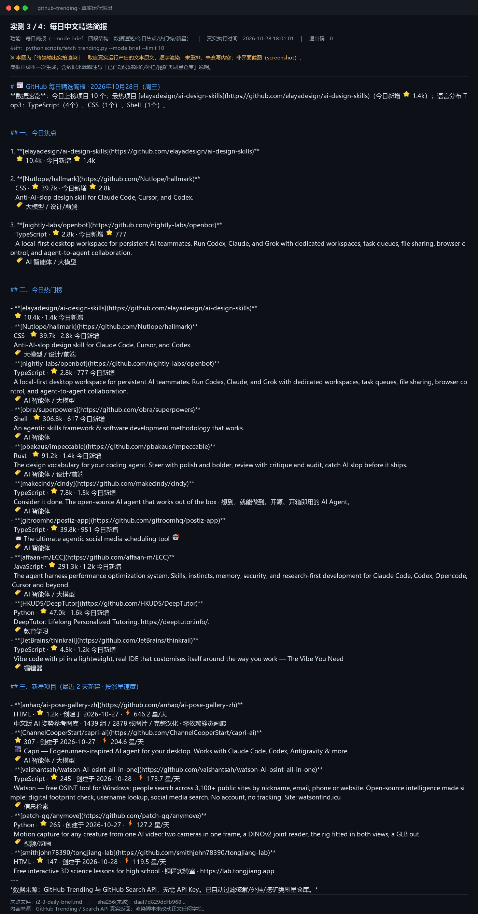

# GitHub 热门项目速览：每天一份中文热榜日报

把 GitHub 的热门与上新项目，整理成一份能直接看的中文日报。

## 这是什么

这是一个运行在 WorkBuddy 里的 skill（技能）：在电脑上使用，不需要注册 GitHub 账号、不需要申请任何 API Key，也不需要自建服务器——数据来自 GitHub 的公开接口。
它按需抓取 GitHub 的热门项目和新星项目，产出一份结构化的中文日报，也能把热门项目转成短视频选题参考。

## 能做什么

- **看热榜**：按需抓取 GitHub 的热门项目与新星项目，附中文分类标签，同一个仓库不会重复出现
  - 边界：这是「按需抓取的准实时」，不是无延迟监控。GitHub 免费接口有限流（搜索约 10 次/分钟），偶发 403 需等约 1 分钟重试
- **出日报**：一键生成结构化的中文日报，分四段——数据速览、今日焦点、热门榜、新星项目，同仓库自动去重
  - 边界：中文成稿依赖 agent 的翻译环节（SKILL.md 要求描述译成中文大白话、禁止照贴英文）；日报里的星标数字必须带「数据日期 + 来源 GitHub Trending」，热度会衰减，旧数据不能当当天数据用
- **转选题**：把一个或多个热门项目转成短视频选题参考，每个选题给出标题、切入点、为什么现在拍
  - 边界：数量用「最多 5 个」，机制是「前 3–5 个热门项目 × 各 1 个选题」，取满即 5 个；选题分析只基于实际抓取到的数据
- **定时日报**：在 WorkBuddy 里创建一次定时任务即可（时间自定义，默认 08:00），日报自动存档
  - 边界：需要你自己配置一次，不是装完就自动跑；抓取失败时会明示「数据不全」，不会静默输出假数据
- **推送到手机/邮箱**：支持推送到 Server酱 / PushPlus / 企业微信机器人 / 邮箱
  - 边界：只说「支持推送到」——推送渠道需要你注册并填入自己的 Key/webhook（留空即禁用该渠道），本项目未在公开环境做过推送实测
- **免 API Key**：全程无需配置 API Key
  - 边界：免 API Key ≠ 无任何限制。免费不等于无限制（GitHub 未登录有限流）；推送渠道的凭证是你自己的 Key，与「免 API Key」不矛盾
- **可选加分项（默认开启/内置）**：
  - 垃圾仓库过滤：默认开启，挡掉刷星、破解、挖矿类仓库，黑名单可自定义
  - 抓取失败自动回退缓存，并给出显著警告
  - 仓库详情免 Key 查询

## 快速开始

环境要求：**需要电脑（WorkBuddy 环境 + Python 3.9+）**；纯手机用户无法运行。

1. 在电脑上装好 WorkBuddy，打开技能市场搜索「GitHub 热门项目速览」，安装这个 skill。
2. 首次使用先跑一次日报，确认能正常出结果：这一步不需要注册 GitHub 账号，也不需要配置 API Key。
3. 如果需要每天自动出日报：在 WorkBuddy 里创建一次定时任务（时间自定义，默认 08:00）。
4. 如果需要推送到微信或邮箱：自行注册 Server酱 / PushPlus / 企业微信机器人，或在邮箱侧准备授权信息，把凭证填进配置（留空即禁用该渠道）。
5. 如果出现 403 或抓取失败：等约 1 分钟重试；连续失败时会回退缓存并提示「数据不全」。

## 不适合谁用

- 需要 7×24 商业级稳定监控的团队：它是个人效率工具，受 GitHub 免费接口限流约束，不做 SLA 承诺
- 完全不想做任何一次性配置的人：定时任务与推送凭证都需要你自己设一次
- 想原样搬运榜单做纯机翻内容的人：skill 设计要求描述译成中文大白话、选题分析不得编造、星标数据不许编，纯搬运既不符合设计也容易踩平台低质内容规则

## 数据与合规说明

- 数据来源：GitHub Trending（热门榜 / 新星榜）。所有榜单数字须带「数据日期 + 来源 GitHub Trending」，热度会衰减，请勿把旧数据当当天数据引用。
- 引用本仓库提及的上榜项目时，请按原项目仓库页注明项目名、作者与许可；各仓库许可证不同，本项目不对第三方项目许可做任何概括声明。
- 本项目的日报与选题由 AI 辅助生成：数字均来自实际抓取的数据，不编造；描述按 skill 要求译成中文大白话，成稿前需人工核改。

## 许可

本项目采用 **MIT** 许可证。许可全文见本仓库根目录的 `LICENSE` 文件。

## 反馈

有问题或建议，请在 **Issues** 里提，附上复现步骤与报错信息即可。
（不在讨论区留微信号、邮箱或二维码——GitHub 社区准则不允许在讨论区发布个人联系方式。）
